# Classical Algebraic Geometry {background=#ac7}

## Ingredients

* Polynomials $f(x, y) = x^2 + y^2 - 1$
* Yielding algebraic curves: $f(x, y) = 0$
    - or surfaces: $x^2 + y^2 + z^2 = 1$
    - General terminology is "a variety" $$V(f) = \{(x, y) : f(x, y) = 0\}$$
* Different number systems (real numbers $\mathbf{R}$, complex numbers $\mathbf{C}$, modular arithmetic $\mathbf{F}_p$)

## Algebraic Curves

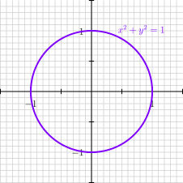

## Classical Results

::: {#thm-bezout}
### Bézout's Theorem
If $f(x, y)$ has degree $p$ and $g(x, y)$ has degree $q$ then generally the system $f(x, y) = 0$, $g(x, y) = 0$ has $pq$ intersections.
:::

## Quadratic and Cubic

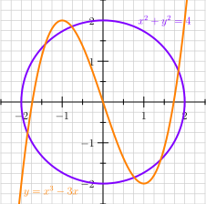

# Tropicalization {background=#ac7}

## Early Origins

1971: George Bergman *The logarithmic limit-set of an algebraic variety*

* Take the (complex) points defined by $f(x, y) = 0$
* Map every point $(x, y)$ to $(\log_b |x|, \log_b |y|)$
* Take the limit of this set as $b \to \infty$
    - ... limit of a set?
    - just go with it...

## {background-iframe="https://www.desmos.com/calculator" background-interactive=true}

## A Tropical Curve

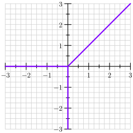

## Primes and Valued Fields

Let $p$ be a prime number.

::: {#def-vp .fragment}
For integers:
$$ v_p(n) = \text{the largest power of $p$ that goes into $n$} $$
:::

::: {#def-vpq .fragment}
For rationals:
$$ v_p(m/n) = v_p(m) - v_p(n) $$
:::

::: {#exm-v5 .fragment}
$$ v_5(200/125) = v_5(5^2 \cdot 2^3) - v_5(5^3) = 2 - 3 = -1 $$
:::

## Arithmetic

1. Same value no matter how we express a fraction: $v_5(200/125) = v_5(8/5)$
2. $v_p(x \cdot y) = v_p(x) + v_p(y)$
3. $v_p(x / y) = v_p(x) - v_p(y)$
4. $v_p(x^k) = kv_p(x)$

::: {#rem-loglike .fragment}
They behave like logarithms
:::

## Min-property {.smaller}
$$v_p(x + y) \ge \min\{v_p(x), v_p(y)\}$$

* e.g.
\begin{align*}
v_5(250 + 200) &= v_5(5^3 \cdot 2 + 5^2 \cdot 2^3) \\
&= v_5(5^2(5 \cdot 2 + 2^3)) = 2
\end{align*}
* More precisely: if $v_p(x) \neq v_p(y)$ then $v_p(x + y) = \min\{v_p(x), v_p(y)\}$
* If $v_p(x) = v_p(y)$ then $v_p(x + y)$ can be any value between $v_p(x)$ and $\infty$ (as long as $p \neq 2$)
    - Wait, what happens when $p = 2$?
    - Investigate yourself!
    - e.g. $v_2(12) = v_2(20) = 2$ but $v_2(32) = 3$

## Equations over valued fields

$$x + y - 1 = 0$$

How do $v_p(x)$ and $v_p(y)$ relate?

* If the minimum of $v_p(x), v_p(y), v_p(-1) = 0$ is unique
    - $v_p(x + y - 1) = \min\{v_p(x), v_p(y), 0\}$
    - $v_p(x + y - 1) \neq v_p(0) = \infty$
    - $x + y - 1 \neq 0$
* So the minimum is not unique
* It occurs at least twice

## "Curves" over valued fields

Start with an equation:

$$V(x + y - 1) = \{x + y - 1 = 0\}$$

::: {.fragment}
Tropicalize:

$$V(\bar{x} \oplus \bar{y} \oplus 0) = \{\text{min occurs at least twice}\} $$
:::

::: {.fragment}
Notation: $V$ means vanishing set or variety, $\oplus = \min$.
:::

## Minimum occurs twice
$$\min\{\bar x, \bar y, 0\}$$

Cases:

* $\min = \bar x = \bar y \le 0$
* $\min = \bar x = 0 \le \bar y$
* $\min = \bar y = 0 \le \bar x$

## {background-iframe="https://www.desmos.com/calculator" background-interactive=true}

## Min-convention Tropical Geometry

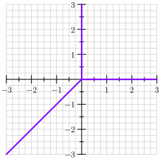

## The two conventions

1. Min-convention $v_p, \min, v_p(0) = \infty$
2. Max-convention $|x|_p = p^{-v_p(x)}, \max, |0|_p = - \infty$
    * exponential can have any base but $p$ is the convention

## Triangles

How to compute the tropical curve associated to a tropical polynomial?

$$ f(x,y) = 75 + 10x - 12y + 25xy $$

::: {.fragment}
Record the valuation $v_5$ at each monomial:

$$ \mathrm{trop}(f) = 2 \oplus \bar 1x \oplus \bar y \oplus 2 \bar x \bar y $$
:::

## Recipe

* For each term $a\bar x^m \bar y^n$ lift the point $(m, n)$ up to a height of $a$.
    - I.e. $(m, n, a)$
* Wrap those points on the bottom with a sheet (lower convex hull).
* Use the folds in the sheet to draw polygons between the points $(m, n)$.
* The tropical curve is the dual graph of this complex.
    - Rotate 180 degrees for min-convention

## Visualization {background-iframe="trop-quartic-three.html" background-interactive=true}

## {background-iframe="trop-elliptic-three.html" background-interactive=true}

## A tropical elliptic curve

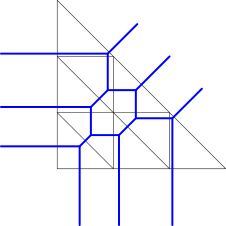

## Tropical Bézout

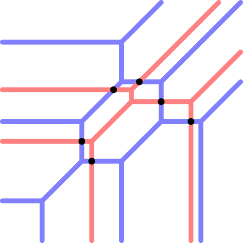

## Mixed Subdivisions

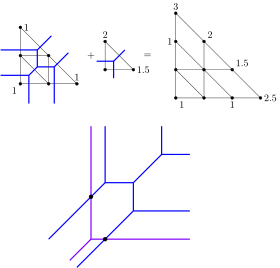

# Part II: Points on Curves {background=#ac7}

## Elliptic Curves

A smooth cubic curve is called an **elliptic curve**

::: {.fragment}
Weierstraß form
$$ y^2 = x^3 + px + q $$
:::

::: {.fragment}
As complex surfaces these are toruses (genus 1)
:::

## {background-iframe="https://www.desmos.com/calculator" background-interactive=true}

## Abstract Tropical Curves

## Abstract Tropical Curves

## Abstract Tropical Curves

## Source

* Imagine we have an equation $f(x,y)$ with integer coefficients.
* We can reduce mod $p$ to curves over the mod-$p$ number system.
* If we have a good equation, i.e. a bad equation, this reduced equation will have self-intersections and intersecting components
    - components correspond to points
    - intersections correspond to connections

## {background-iframe="https://www.desmos.com/calculator" background-interactive=true}

## Dollars on Graphs

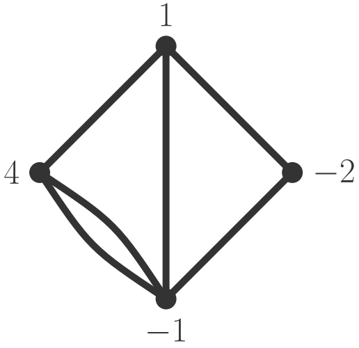

* For a classical curve: $P + Q + R = 0$ if they are colinear
* For a tropical curve we have borrowing moves

## Dollars on Graphs

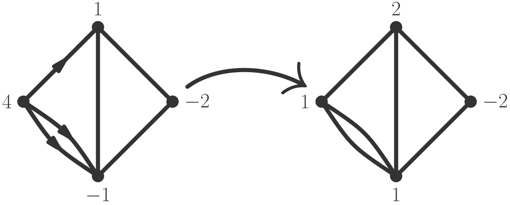

* At any point, a vertex may send 1 dollar simultaneously to each of its neighbours
* Question: can we get everyone out of debt?

## Example 1

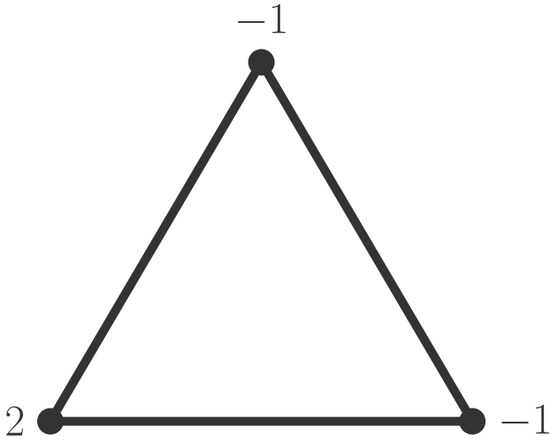

## Example 2

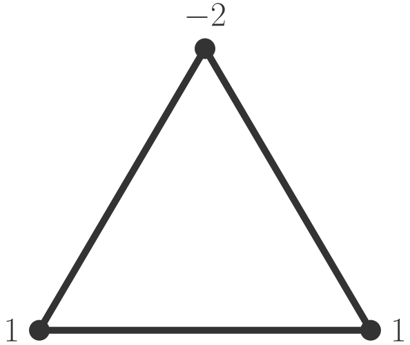

## Example 3

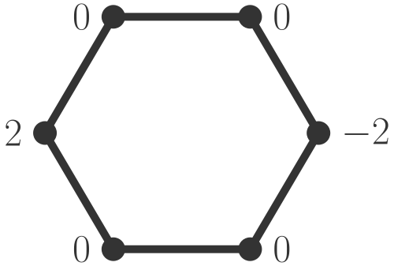

## Rank Function

Let $D$ represent a given dollar game.

* If $D$ is unwinnable, define $r(D) = -1$
* If $D$ is only just winnable, i.e. $D$ is winnable but if we take a dollar away from $v$, $D - v$ is unwinnable, define $r(D) = 0$
* Say $r(D) \ge k$ if taking away any $k$ dollars anywhere leaves a winnable game
* $r(D)$ will be the maximum $k$

## Degree Function

$$\deg(D) = \text{total dollar amount of } D$$

## Riemann-Roch Theorem

If a graph has genus $g$ then for any game $D$

$$r(D) \ge \deg(D) + 1 - g$$

## Classical Riemann-Roch {.smaller}

If a surface has genus $g$, and $D$ is a finite set of points with multiplicities. Consider the set of rational functions whose poles are not worse than the numbers specified in $D$.

::: {.fragment}
E.g. $$f = \frac{(x + 2)^4(x - 3)}{(x + 5)^3(x - 7)}$$

$$\mathrm(f) = \{4 \text{ at } -2, 1 \text{ at } 3, -3 \text{ at } -5, -1 \text{ at } 7\}$$
:::

::: {.fragment}
This is ok for $D$ = no worse than $-3$ at $-5$ and no worse than $-2$ at $7$.
:::

## Classical Riemann-Roch (cont.)

A sum of two rational functions which is ok for $D$ is also ok for $D$. Likewise any constant multiple is ok for $D$.

::: {.fragment}
I.e. it is a vector space
:::

::: {.fragment}
Let $\ell(D)$ be the dimension of this space.
:::

::: {#thm-RR .fragment}
### Riemann-Roch
$$\ell(D) \ge \deg(D) + 1 - g$$
:::
